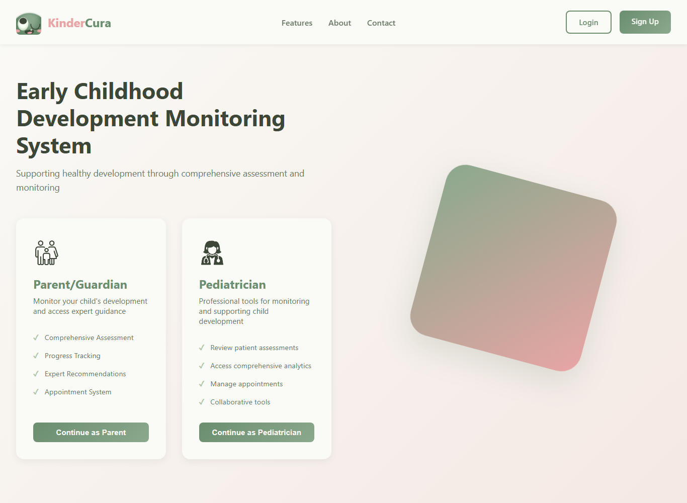
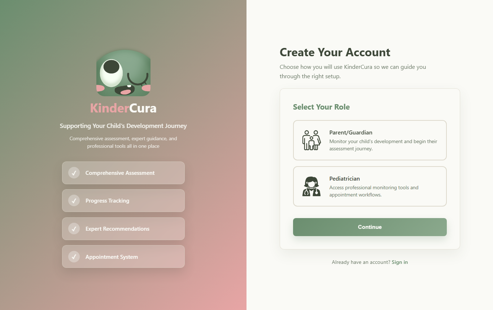
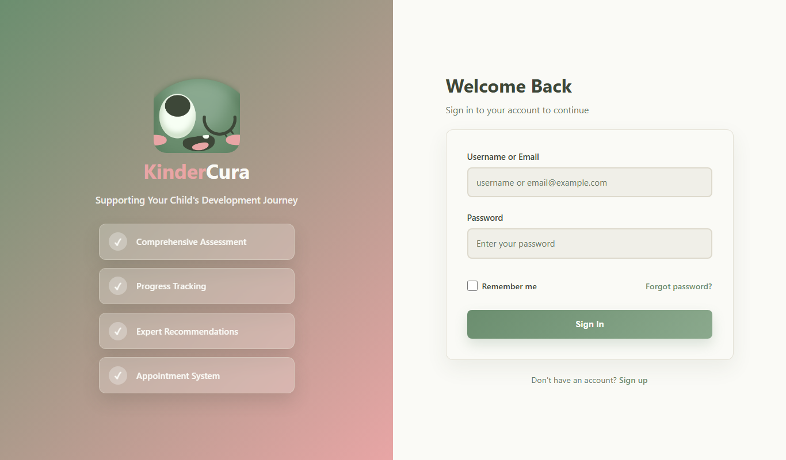

<!-- cover-start -->
# KinderCura System User Manual

**Early Childhood Development Monitoring System**

User Guide for Parents and Guardians, Pediatricians, Clinic Assistants/Secretaries, and Administrators

Version 1.0 · October 2026
<!-- cover-end -->

<!-- toc-start -->
## Table of Contents

1. Introduction
2. System Requirements
3. Getting Started
4. Parent User Guide
5. Pediatrician User Guide
6. Secretary User Guide
7. Admin User Guide
8. Assessment and Results
9. Reports and Data Presentation
10. Troubleshooting
11. Security and Best Practices
12. Frequently Asked Questions
13. Glossary

Appendix A. List of Figures
Appendix B. Items That Could Not Be Fully Verified
<!-- toc-end -->

# Chapter 1. Introduction

## 1.1 Overview of KinderCura

KinderCura is a web-based early childhood development monitoring system. It helps parents and pediatricians work together to screen, track and support the development of children aged 3 to 8 years.

The system is used by four kinds of users:

- **Parents and guardians** register their children, answer a developmental assessment, view results and recommendations, book appointments, pay for consultations, and chat with the pediatrician.
- **Pediatricians** review their patients' assessment results, record diagnoses and check-ups, create extra (custom) assessment questions, manage appointments, and view reports about their own patients.
- **Clinic Assistants/Secretaries** handle appointment requests, rescheduling and walk-in (cash) payments for the one pediatrician they are linked to. They cannot see assessment results or diagnoses.
- **Administrators** manage user accounts, verify pediatrician licenses, monitor payments, register clinics, view system-wide reports and analytics, and manage the datasets and models used by the optional prediction feature.

## 1.2 Purpose of the System

KinderCura supports early identification of children who may need closer attention in four developmental areas: **Communication**, **Social Skills**, **Cognitive**, and **Motor Skills**. It gives parents an easy way to record what they observe, gives pediatricians organized information for follow-up, and connects families to a clinic through appointment booking and payment.

KinderCura is a **screening and monitoring support tool**. It does **not** provide a medical diagnosis, treatment, therapy, or emergency services. Only a pediatrician can make a diagnosis.

## 1.3 Purpose of This User Manual

This manual explains, step by step, how each type of user signs in, moves around the system, and uses each feature that is available to them. It also explains how assessment scores are calculated and how to read the reports.

## 1.4 Intended Users

| User | Typical person | Chapter |
|---|---|---|
| Parent / Guardian | Mother, father, legal guardian, foster parent, court-appointed guardian, or a family member invited by the parent | Chapter 4 |
| Pediatrician | A licensed pediatrician whose PRC license has been verified by an administrator | Chapter 5 |
| Assistant/Secretary | A clinic staff member whose account was created by a pediatrician | Chapter 6 |
| Administrator | A system administrator of the KinderCura deployment | Chapter 7 |

## 1.5 Scope and Limitations

This manual covers the features that are present in the current KinderCura application. Please keep these limitations in mind:

- **Age range.** Children can be registered and assessed only if they are between **3 and 8 years old**.
- **Scores are not age-normed.** The child's age decides *which* questions are asked, but every child's answers are judged against the same score ranges. The score ranges (80/60/40) have not yet been confirmed as clinically validated.
- **Not a diagnosis.** Score bands, risk categories and care stages are screening information only.
- **Some screens are not yet functional.** A few buttons only display a message and do not save anything (for example, several options on the parent **Settings** page and on the admin **System Settings** page). These are clearly marked in this manual.
- **Screenshots.** Only public pages (landing, sign-up and login) were captured from the running application. Screens that require signing in are shown as labelled placeholders, because capturing them would have exposed real records. See Appendix A.

# Chapter 2. System Requirements

## 2.1 Supported Browsers and Devices

KinderCura is a website. There is nothing to install.

- Use an up-to-date version of a modern web browser such as Google Chrome, Microsoft Edge, Mozilla Firefox or Safari. *(The project does not publish an official list of supported browsers; this is a general recommendation.)*
- The pages work on desktop computers, laptops, tablets and phones. On small screens, the main menu collapses into a menu button (**☰**, labelled "Open menu").
- JavaScript and browser storage (local storage) must be enabled. KinderCura keeps your sign-in session in the browser's local storage.

## 2.2 Internet and Network Requirements

- A stable internet connection is required. All data is stored online.
- Charts on dashboards and reports are drawn with a chart library loaded from the internet. If it is blocked by a network filter, charts will not appear, but the numbers and tables will still load.
- Online payment (GCash or Maya) opens the payment provider's secure checkout page in the browser.

## 2.3 Other Requirements

| Requirement | Who needs it | Details |
|---|---|---|
| Email address | All users who register | Used for the 4-digit sign-up verification code, invitations and notices. |
| Philippine mobile number | Pediatricians | Required on the pediatrician registration form (format 09XXXXXXXXX). |
| Photo of PRC ID | Pediatricians | JPG or PNG, up to 5 MB. |
| Profile photos (optional) | Parents, pediatricians | JPG or PNG, up to 5 MB at sign-up. |
| Camera (optional) | Assistant/Secretary | For scanning a parent's payment QR code on the **Cashier** page. A USB/Bluetooth QR scanner or typing the reference also works. |
| Video files (optional) | Parents, pediatricians | Videos attached in **Chat** must be under 150 MB. |

# Chapter 3. Getting Started

## 3.1 Accessing the System

1. Open your web browser.
2. Go to the KinderCura web address given to you by your clinic or administrator.
3. The **landing page** opens (Figure 3.1). It shows the **Features**, **About** and **Contact** sections and two buttons at the top right: **Login** and **Sign Up**.

*Figure 3.1. KinderCura landing page (captured from the application).*

## 3.2 Creating an Account (Sign Up)

Only **parents/guardians** and **pediatricians** can create their own accounts. Assistant/Secretary accounts are created by a pediatrician (Section 5.10), and administrator accounts are not created through the website.

*Figure 3.2. The first sign-up step, "Select Your Role" (captured from the application).*

### 3.2.1 Signing up as a Parent/Guardian

1. Click **Sign Up** on the landing page, or **Continue as Parent**.
2. Under **Select Your Role**, choose **Parent/Guardian** and click **Continue**.
3. **Child Information.** Enter your child's details:
   - **Child's Profile Picture** (optional) – click **Upload Photo**.
   - **Child's First Name** and **Child's Last Name** (legal name), and **Child's Middle Name** (optional).
   - **Date of Birth** – the child must be between ages 3 and 8.
   - **Gender** – Male or Female.
   Click **Continue**.
4. **Your Information.** Enter your **First Name**, **Middle Name** (optional), **Last Name**, and **Relationship to Child** (Mother, Father, Guardian or Grandparent). Click **Continue**.
5. **Login Credentials.** Enter a **Username**, **Email Address**, **Password** (at least 8 characters) and **Confirm Password**. Click **Continue**.
6. **Terms of Service and Consent.** A window opens. Read the terms, then:
   - Tick **Required Terms Acceptance** (you agree to the Terms of Service).
   - Tick **Privacy Notice Acknowledgment** (required).
   - Optionally tick **Optional Machine Learning Consent** if you agree that your eligible information may be used to train and improve KinderCura's prediction models. This is voluntary.
   Click **I Agree & Continue**.
7. **Verify Your Email.** A 4-digit code is sent to your email address. Type the four digits and click **Verify & Continue**. If the code did not arrive, click **Resend Code** (also check your spam folder). The code expires after 10 minutes.

**Result:** Your account is created. When you sign in for the first time, KinderCura opens the **pre-assessment** for your child (see Section 4.3).

**Common messages:**

- *"Your child is below the eligible age range…"* or *"…above the eligible age range…"* – the date of birth is outside 3–8 years.
- *"Please enter a valid date of birth before continuing. The date of birth cannot be in the future."*
- *"Email already in use."* – an account already exists with that email.
- *"Invalid OTP."* / *"OTP expired."* – re-type the code or request a new one.

### 3.2.2 Signing up as a Pediatrician

1. Click **Sign Up**, choose **Pediatrician**, and click **Continue**.
2. **Personal Information.** Optional **Profile Picture**, then **First Name**, **Middle Name** (optional) and **Last Name**. Click **Continue**.
3. **Login Credentials.** **Username**, **Email Address**, **Password** (at least 8 characters), **Confirm Password**. Click **Continue** and accept the Terms of Service and Consent window as described above.
4. **Verify Your Email.** Enter the 4-digit code and click **Verify & Continue**.
5. **Professional Information & PRC Verification.** Fill in:
   - **PRC ID / Professional ID** * – upload a clear photo of the front of your PRC ID (JPG/PNG up to 5 MB).
   - **PRC License Number** * – exactly as shown on the card.
   - **Hospital / Institution** (optional), **Clinic Name**, **Clinic Address**.
   - **Phone Number** * – an active Philippine mobile number.
   - **PRC License Expiry Date** * – must be a future date.
   - **Specialization** – General Pediatrics, Developmental Pediatrics, Pediatric Neurology, Child Psychiatry, or Other (Please specify).
6. Click **Submit for Verification**.

**Result:** The message **Registration Submitted Successfully!** appears. Your account is **pending admin approval**. You can sign in only after an administrator verifies your PRC credentials (Section 7.4). Click **OK — Go to Login**.

## 3.3 Login Instructions

*Figure 3.3. Login page (captured from the application).*

1. Click **Login** on the landing page.
2. In **Username or Email**, type your username or your email address.
3. In **Password**, type your password.
4. Click **Sign In**.

**Result:** KinderCura opens the home page for your role:

| Role | Page opened after login |
|---|---|
| Parent / guardian | Parent **Dashboard** (or the **Developmental Assessment** page if the child's first assessment has not been done yet) |
| Pediatrician | **Pediatrician Dashboard** |
| Assistant/Secretary | **Assistant/Secretary Dashboard** |
| Administrator | **Administrator Dashboard** |

**Notes:**

- If you are already signed in on that browser, the login page shows: "You already have an active session as …". You may sign in to another account or keep using the current one.
- A sign-in session lasts up to **48 hours**. After that you must sign in again.
- The **Remember me** checkbox and the **Forgot password?** link are shown on the page but are **not functional** in the current version (see Section 3.7).

## 3.4 Dashboard Overview

Each role has its own dashboard. All dashboards share the same layout:

- **Top bar** with the KinderCura logo (click it to return to the dashboard), the role's menu links, the **notification bell**, and the **profile button** (your photo or initials).
- **Main area** with summary cards, charts and lists for that role.

Role-specific dashboards are described in Sections 4.2 (Parent), 5.2 (Pediatrician), 6.2 (Secretary) and 7.2 (Admin).

## 3.5 Navigation Menus and Interface Elements

| Role | Main menu items |
|---|---|
| Parent / guardian | Dashboard · Results · Reports · Recommendations · Appointments · Chat · Questions |
| Pediatrician | Dashboard · My Patients · Reports · Appointments · Chat · My Questions |
| Assistant/Secretary | Dashboard · Approvals · Appointments · Cashier · Patients |
| Administrator | Dashboard · Users · PRC Verification · Analytics · Training · Reports · a **more** (▾) menu containing Insights, Payments and Question Origin |

**Profile menu.** Click the profile button at the top right to open a small menu:

- Parents: **Profile**, **Settings**, **Logout**.
- Pediatricians: **Profile**, **Settings**, **Help & Support**, **Logout**.
- Administrators: **Settings**, **Help & Support**, **Logs**, **Logout**.

*Note: the **Help & Support** and **Logs** links do not lead to a working page in the current version.*

**Notification bell.** The bell shows the number of unread notifications. Click it to open the **Notifications** window:

- Click a notification to go to the related page (for example, an appointment or a result). It is then marked as read.
- **Mark all read** marks every notification as read.
- **Clear all** removes all notifications from the list.
- Assistant/Secretary accounts do not receive notifications.

**Common interface elements:** buttons, drop-down lists (selects), date pickers, pop-up windows ("modals") with **Cancel**/**Close** buttons, coloured status badges (for example *Pending*, *Approved*, *Completed*), and "Loading…" text while data is being fetched.

## 3.6 Logout Instructions

1. Click the profile button at the top right (or **Log Out** in the menu on small screens).
2. Click **Logout**.

**Result:** Your session is removed from the browser and the login page opens. Always log out on shared computers.

## 3.7 Account Access Problems

| Problem | What to do |
|---|---|
| "Invalid email/username or password." | Check spelling, Caps Lock and whether you used the right username or email. |
| "Your pediatrician account is still pending admin approval." | Wait for an administrator to verify your PRC license. |
| "Your account is not yet active. Please contact the clinic administrator." | The account is pending; contact your administrator. |
| "Your account has been suspended." | Contact the administrator. Suspended accounts cannot sign in. |
| "Token invalid or expired. Please log in again." | Your 48-hour session ended. Sign in again. |
| Forgot password | There is no self-service password reset. Contact the clinic or administrator. If you are signed in, you can change your password from **Profile** (Sections 4.12 and 5.9). |
| Sign-up code not received | Click **Resend Code** and check the spam folder. If you see "Email service is not configured. Please contact support.", contact the administrator. |

# Chapter 4. Parent User Guide

This chapter is for parents and for guardians who use the parent pages (legal guardian, foster parent, court-appointed guardian, and family members linked by the parent). What a linked guardian can see or do depends on the permissions the main parent gave them (Section 4.11).

## 4.1 Parent Feature Summary

| Feature | Menu / location | Purpose |
|---|---|---|
| Dashboard | **Dashboard** | Summary of your child, latest scores, recommendations and appointments |
| Developmental Assessment | **Reassessment** / **Start Assessment** buttons | Answer the screening questions |
| Results | **Results** | View scores, care plan and pediatrician diagnosis |
| Progress Report | **Reports** | View score trends and full assessment history |
| Recommendations | **Recommendations** | Home activities and suggested clinics |
| Appointments | **Appointments** | Book and reschedule consultations, view receipts |
| Payment | Opens after booking | Pay online or get a clinic QR code |
| Chat | **Chat** | Message the pediatrician |
| Custom Questions | **Questions** | Answer extra questions from the pediatrician |
| Profile | Profile menu › **Profile** | Edit your details, change password, add children |
| Settings / Guardians | Profile menu › **Settings**; **Manage Guardians** | Add family members and manage guardian access |

## 4.2 Parent Dashboard

**Purpose:** gives a quick overview of the selected child.

**How to access:** sign in, or click **Dashboard** in the menu.

> **Figure 4.1 — Screenshot placeholder.** Add a screenshot of the parent **Dashboard** (`/parent/dashboard.html`) taken with a test parent account that contains fictional data only.

**What you see:**

- **Child header** – the child's name, age and birthdate, with **Edit Profile** and **Manage Guardians** buttons. If no child is registered, it shows "No child registered – Go to Profile to add a child".
- **Skill Overview** – the child's score (%) in each of the four areas from the latest completed assessment.
- **Latest Assessment** – the date and area scores of the latest assessment, with **View Detailed Results**.
- **Recommendations** – a short list, with **View Full Recommendations**, and a progress bar showing how many home activities have been ticked as done.
- **Quick Actions** – **Reassessment**, **View Results**, **Book Appointment**, **Custom Questions**.
- **Appointment Overview** – a chart of your appointments by status (cancelled and rejected appointments are not counted).
- **My Children** – how many children are registered under your account.
- **Latest Notifications** – your most recent notifications.

## 4.3 Answering the Developmental Assessment

**Purpose:** record what you observe about your child so KinderCura can calculate area scores.

**How to access:** click **Reassessment** (Dashboard, Results or Recommendations), **Start Assessment** (Results page or a child card on Profile). After you register a child, or on your first login, the assessment opens automatically (this first one is called the *pre-assessment*).

> **Figure 4.2 — Screenshot placeholder.** Add a screenshot of the **Developmental Assessment** page (`/parent/screening.html`) showing one question and the **Assessment Progress** panel, using a fictional test child.

**Steps:**

1. Check the **Child Info** panel. It shows the child's exact age, the age group (for example "Preschool (3-5 years)") and how many questions are in this assessment.
2. Read the question shown in the card, for example "Does your child draw a circle?". The card shows "Question X of Y", the developmental sub-area (for example *Fine Motor*) and the area it is "Scored under".
3. Under **How would you answer?**, choose one answer:
   - **Yes, consistently**
   - **Sometimes**
   - **Not yet**
4. Click **Next Question**. To change an earlier answer, click **← Back**.
5. Questions from your pediatrician (marked **Pediatrician Question**) may appear after the standard questions. Answer them with **Yes/No**, one of the given choices, or by typing in the text box.
6. On the last question, click **Complete Assessment ✓**.

**Result:** The page shows "Submitting assessment… Please wait while KinderCura calculates the result." and then returns you to the **Dashboard**, where the new scores appear. The full result is on the **Results** page.

**Assessment Progress panel:** shows how many questions you have answered in each area (answered/total) and an overall percentage. *This is your progress, not your child's score.*

**Restrictions and messages:**

- "Please answer the question before continuing." – you must choose an answer before moving on.
- "No child registered. Please complete your profile first." – add a child first (Section 4.12).
- "This assessment is available for children aged 3 to 8 only." / "Child must be between ages 3-8 for assessment."
- "Submission failed: …" – click **Retry**. Your answers are kept on the page.
- Your progress is saved in the background every 5 answers, but answers to pediatrician questions are saved only when you complete the assessment.

How the score is calculated is explained in Chapter 8.

## 4.4 Viewing Results

**Purpose:** see the scores and follow-up information for an assessment.

**How to access:** click **Results** in the menu, or **View Results** / **View Detailed Results** on the Dashboard.

> **Figure 4.3 — Screenshot placeholder.** Add a screenshot of the **Assessment Results & Analysis** page (`/parent/results.html`) for a fictional test child.

**What you see (top to bottom):**

1. **Child selector** – appears when you have more than one child. Choose a child to switch.
2. **Next Assessment** banner – the follow-up date set by the pediatrician, or "No follow-up scheduled yet.", with an **Appointments** button.
3. **Pediatrician Diagnosis** banner – appears after the pediatrician has reviewed the assessment. Click **View Diagnosis** to read the **Diagnosis**, the **Recommendation for Parent**, and the **Next Assessment** date.
4. **Overall Score** – the average of the four area scores, with a status label (On Track, Developing, or Needs Support), a short explanation ("What does X% mean?"), and any risk notes (for example "Communication delay detected").
5. **Area scores** – Communication, Social Skills, Cognitive and Motor Skills, each with a label (Excellent, Good, Fair, Needs Attention) and a **Score Guide**.
6. **Developmental Assessment & Care Plan** – Developmental Band, Developmental Risk Category, Care Stage, Consultation and Monitoring (explained in Section 8.6).
7. **Area cards** – one per area. Click the details toggle to see the answers behind the percentage. If there was an earlier assessment, switch between **Previous** and **Present**.
8. **Progress Since Last Assessment** – a comparison with the previous completed assessment and a table of **Scores by Developmental Area**. On the first assessment it says there is nothing to compare yet.
9. **Next Steps** – **View Recommendations**, **Book Appointment**, **Reassessment**.

If there is no completed assessment, the page says "No assessment results yet" with a **Start Assessment** button.

## 4.5 Viewing the Progress Report

**Purpose:** follow your child's scores over time and see the pediatrician's check-up history.

**How to access:** click **Reports** in the menu.

> **Figure 4.4 — Screenshot placeholder.** Add a screenshot of the **Progress Report** page (`/parent/reports.html`) for a fictional child with at least two assessments.

**Sections:**

- **About this report** – a reminder that results are not a diagnosis.
- **How to read the scores** – a table of score ranges, colours, area labels and overall labels.
- **Pediatrician Review & Next Follow-up** – the latest review and follow-up date, with **Book an appointment** / **Appointments** buttons.
- **Score over time** – a line chart of the overall score for each completed assessment. At least two assessments are needed; otherwise it shows "Not enough assessments yet to show a trend" and a **Start an assessment** / **Start another assessment** button.
- **Most recent assessment** – the four area scores of the latest assessment.
- **Worth talking through** – appears when the latest overall score is in the At-Risk or Delayed range and no pediatrician recommendation has been recorded yet, with **Book an appointment**.
- **Assessment history** – every completed assessment, newest first, with date and age, the four area scores, the overall score, an interpretation compared with the previous assessment, and review/follow-up status.
- **Check-up / Medical History** – the pediatrician's recorded visits (visit type, status, diagnosis, findings, recommendation, next follow-up) and any specialist referrals. This section is read-only.

## 4.6 Recommendations and Home Activities

**Purpose:** get suggested home activities for each developmental area and find a suitable pediatrician or clinic.

**How to access:** click **Recommendations** in the menu, or **View Recommendations** on the Results page.

> **Figure 4.5 — Screenshot placeholder.** Add a screenshot of the **Personalized Recommendations** page (`/parent/recommendations.html`) for a fictional child.

**What you see:**

- **Developmental Assessment & Care Plan** – the same summary as on the Results page.
- **Schedule Professional Consultation** – appears when at least one area is below 80% and the child has no booked consultation yet. It lists the focus areas and has a **Book Appointment Now** button. If a consultation is already booked, the message "Consultation already scheduled" appears instead.
- **Suggested Pediatricians / Clinics** – active pediatricians, ordered by how well their specialization matches the child's focus areas. Click **Book With This Clinic** to book, or **View Appointment** if already booked.
- **Home Activity Progress** – how many recommended activities are done.
- **How the recommendation labels work** – the meaning of each label.
- **One card per area** – for example "Communication Development", with a label (**Keep Up Great Work**, **Monitor Progress** or **Needs Attention**), a suggestion and a list of **Recommended Activities**.
- **Next Steps** – **Back to Results**, **Appointments**, **Reassessment**.

**To mark an activity as done:**

1. Find the activity under **Recommended Activities**.
2. Tick its checkbox ("Tick an activity once your child has done it.").
3. To undo, untick it.

**Result:** the progress bar updates, and the progress also shows on the Dashboard.

## 4.7 Booking an Appointment

**Purpose:** request a consultation with a pediatrician.

**How to access:** click **Appointments** in the menu, or any **Book Appointment** button.

> **Figure 4.6 — Screenshot placeholder.** Add a screenshot of the **Manage Appointments** page (`/parent/appointments.html`) showing the **Book New Appointment** form.

**Steps:**

1. In **Selected Child**, choose the child.
2. Optionally, review **Suggested Pediatricians / Clinics** (top three matches) and click **Choose This**, or pick from **Suggested / Available Pediatrician**.
3. Review the selected pediatrician's clinic details, consultation fee, **Available Days**, **Hours** and **Maximum Patients Per Day**.
4. Choose a **Preferred Date**.
5. Choose a **Preferred Start Time**. Depending on the clinic setting, you either pick from a list of open start times or type a time. The availability panel shows whether the time is available and which times are already booked.
6. Choose a **Reason for Visit**: Follow-up Assessment, Motor Skills Evaluation, Development Check, Concern Discussion, or General Check-up.
7. Optionally type **Additional Notes**.
8. Click **Book Appointment**.

**Result:** the appointment is saved with status **Pending** and you are taken to the **Select Payment Method** page (Section 4.8).

**Validation messages:**

| Message | Meaning |
|---|---|
| Please select a child. / Please select a pediatrician. / Please select a date. / Please select a time. | A required field is empty. |
| This pediatrician has not finished saving appointment availability yet. | Choose another pediatrician. |
| This pediatrician is not available on (day). Please choose one of the available days. | Pick one of the listed available days. |
| Please choose today or a future date. | Past dates are not allowed. |
| Please choose a time between (start) and (end). | The time is outside working hours. |
| This start time is already booked. Please choose another time. | Someone else has that slot. |
| This pediatrician is already fully booked for (date). Please choose another date. | The daily limit was reached. |
| Please choose a time outside of the provider break schedule. | The time falls in a break. |

## 4.8 Paying for an Appointment

**Purpose:** choose how to pay the consultation fee. Booking and payment are separate steps.

**How to access:** this page opens automatically after you click **Book Appointment**.

> **Figure 4.7 — Screenshot placeholder.** Add a screenshot of the **Select Payment Method** page (`/parent/payment.html`) showing the two payment options.

The page shows the appointment summary (number, patient, pediatrician, date and time, reason and consultation fee) and two options:

**Option A – Pay Online (GCash or Maya)**

1. Click **Pay Online**. The button changes to "Opening secure checkout…".
2. Complete the payment on the payment provider's page.
3. You return to KinderCura, which shows "Confirming your payment…". Do not close the page.
4. **Result:** "✓ Payment Successful" appears with your receipt. Click **Print Receipt** to print it, or **Back to Appointments**. If payment did not finish, "Payment was not completed. No money has been taken from your account." appears; click **Choose a payment method again**.

**Option B – Pay at Clinic**

1. Click **Get Clinic QR**.
2. A QR code appears with the **Payment reference** and **Amount due at the counter**.
3. Show this QR code (or the reference) to the clinic secretary when you arrive. The secretary scans it and confirms your cash payment.
4. Click **Choose a different method** if you change your mind, or **Back to Appointments**.

**Notes:**

- If the appointment is already paid, the page shows the receipt instead of the options.
- A pediatrician or secretary can approve an appointment only after at least **30%** of the consultation fee has been paid (or it is fully paid), unless no fee is set.
- *Older records may show the statuses "Walk-in Selected" or "Payment Verification Pending" from an earlier payment process.*

## 4.9 Managing Your Appointments

On the **Appointments** page, under **Your Appointments**:

- **Active** – Pending and Approved appointments. Each card shows the pediatrician, clinic, address, date and time, reason, child, status and payment summary (status, amount paid, balance).
  - Pending: "Your request is being reviewed by the clinic staff."
  - Approved: "Confirmed by clinic staff on behalf of Dr. …"
- **Past / Closed** – Completed, Cancelled and Rejected appointments.

**View a receipt:** click **Receipt** on an appointment card. A **Payment Receipt** window shows Total Due, Amount Paid, Remaining Balance and each payment transaction.

**Reschedule an appointment:**

1. On a Pending or Approved appointment, click **Reschedule**.
2. In the **Reschedule Appointment** window, choose a **New Date**, then a **New Start Time** from the open times.
3. Choose a **Reason for Rescheduling** (Family emergency, Child is unwell, Schedule conflict, Travel / away, Prefer a different time, Other) and optionally a **Note**.
4. Click **Confirm Reschedule**.

**Result:** only the date and time change. Payment, receipt and status stay the same, and the card shows "Rescheduled from …".

**Restrictions:** only Pending and Approved appointments can be rescheduled. The new time must pass the same availability checks as booking. *The parent page does not have a Cancel button; contact the clinic to cancel.*

**Chat:** on Approved appointments, click **Chat with Dr. …** to open the chat.

## 4.10 Chat with the Pediatrician

**Purpose:** send messages and short videos to the pediatrician about an appointment.

**How to access:** click **Chat** in the menu, or **Chat with Dr. …** on an approved appointment.

1. Under **My Conversations**, choose an approved (or completed) appointment.
2. Type your message in the box ("Type a message…").
3. To attach a video, click the attach button and choose a video file (under 150 MB).
4. Press **Enter** or click the send button. Press **Shift+Enter** for a new line.

**Result:** the message appears in the conversation. New messages load automatically every few seconds. Chat is available only for Approved and Completed appointments.

## 4.11 Answering Custom Questions

**Purpose:** answer extra questions your child's pediatrician assigned.

**How to access:** click **Questions** in the menu, or **Custom Questions** on the Dashboard.

1. Choose a child in the drop-down, or keep **All children**.
2. Under **Pending Answers**, answer each question:
   - Yes/No questions: click **Yes** or **No**.
   - Multiple-choice questions: click one choice.
   - Text questions: type in the box.
3. For a single question, click **Submit Answer**. For a question set, answer all questions and click **Submit Complete Set** (or **Clear Answers** to start the set again).
4. Use **Refresh** to reload and **Back to Appointments** to leave.

**Result:** the answer moves to **Answered Questions** and the pediatrician is notified.

*Pending pediatrician questions are also included at the end of your next Developmental Assessment. Yes/No pediatrician questions answered there count toward the area score; see Section 8.3.*

## 4.12 Profile and Child Management

**How to access:** profile menu › **Profile**, or **Edit Profile** on the Dashboard.

- **Change your photo:** click the photo ("Click to change photo") and choose an image.
- **Edit your name:** click **Edit Profile**, change **First Name**/**Last Name**, click **Save**.
- **Change password:** click **Change Password**, enter **New Password** (at least 8 characters) and **Confirm Password**, then click **Update**. Message: "Password changed successfully!".
- **Child Profile:** each child has a card with a **Start Assessment** button and a photo upload.
- **Add another child:**
  1. Click **Add Another Child**.
  2. Enter **First Name**, **Middle Name (Optional)**, **Last Name**, **Date of Birth**, **Gender** and **Relationship (Optional)**.
  3. Click **Add Child**.
  4. **Result:** the child is saved and the pre-assessment opens automatically.
  - Messages: "First name, last name and date of birth are required."; the 3–8 age messages; "This child is already registered for this parent."

## 4.13 Settings, Family Members and Guardian Management

### 4.13.1 Settings page

**How to access:** profile menu › **Settings**. The page has tabs: **Account**, **Notifications**, **Privacy**, **Family**, **Data**.

**Working feature – Family tab (Add Family Member):**

1. Open the **Family** tab and choose a child in **Select Child**. Linked family members are listed.
2. Under **Add Family Member**, enter **First Name**, **Last Name**, **Email**, **Password** (minimum 8 characters), **Relationship** (Mother, Father, Grandparent, Legal Guardian, Foster Parent, Other) and **Permission Level** (Full Access, Standard Access, Medical Only, Limited Access).
3. Click **Create Account**.
4. **Result:** the family member's account is created and linked to the child immediately. They receive a confirmation email, but **the password is not emailed** – share it privately. They can change it later from Profile › Change Password.

**Not yet functional:** on the **Account**, **Notifications**, **Privacy** and **Data** tabs, the buttons **Change Email**, **Change Password**, **Sign Out Everywhere**, the 2FA switch, **Save Preferences**, **Save Settings**, **Download Data** and **Delete Account** only display a message and do not change anything. Use the **Profile** page to change your password.

### 4.13.2 Guardian Management

**Purpose:** invite people who already have, or will create, a KinderCura account to access a child's records, and control what they can do.

**How to access:** **Manage Guardians** on the Dashboard, or **Open Guardian Management** on the Settings › Family tab.

> **Figure 4.8 — Screenshot placeholder.** Add a screenshot of the **Guardian Management** page (`/parent/guardians`) with fictional invitations.

**Send an invitation:**

1. Check the **Selected child** at the top (switch if you have several children).
2. Enter the person's **Email** and choose a **Relationship** (Mother, Father, Grandparent, Legal Guardian, Foster Parent, Court-Appointed, Nanny / Babysitter, Therapist, Teacher, Other).
3. Choose a **Permission Preset**:

| Preset | Includes |
|---|---|
| Full Access | View and submit assessments, view results and recommendations, upload documents, manage appointments, view medical records, modify child profile, invite guardians, revoke access, view and send messages, view notifications |
| Standard Access | View assessments and results (and recommendations), view chat messages, view notifications |
| Medical Only | View medical records, manage appointments |
| Limited Access | View assessment results (and recommendations) |
| Custom | Tick individual permissions |

4. Optionally add a **Personal Message** (up to 1,000 characters).
5. Click **Send Invitation**.

**Result:** the invitation appears under **Pending Invitations** with its expiry (48 hours). If the email could not be delivered, a warning shows a link you can copy with **Copy link** and share directly.

**Manage invitations and guardians:**

- **Pending Invitations:** **Resend** or **Revoke** (the link stops working).
- **Linked Guardians:** for active, non-primary guardians: **Edit** (change permissions and click **Save Permissions**), **Transfer** (make them the primary guardian, then **Confirm Transfer**), **Revoke** (remove their access).
- Only the primary parent or guardian of the child can view and manage linked guardians.

**Accepting an invitation (for the invited person):** open the link in the email. The **Guardian Invitation** page shows who invited you, the child, the permissions and any message. Click **Log In** (existing account) or **Create Account**, then **Accept** or **Decline**. After accepting, click **Go to Dashboard**.

# Chapter 5. Pediatrician User Guide

## 5.1 Pediatrician Feature Summary

| Menu | Purpose |
|---|---|
| Dashboard | Appointment counts, pending requests, review progress, recent activity |
| My Patients | Review assessments, provide diagnoses, record check-ups, referrals and notes |
| Reports | Reports about your own patients, with CSV export |
| Appointments | Approve, reject, complete, reschedule or cancel appointments |
| Chat | Message parents of approved appointments |
| My Questions | Create, assign and track custom assessment questions |
| Profile / Settings | Professional details, availability, fees, staff (secretary) accounts |

Your patients are the children who have at least one appointment with you.

## 5.2 Pediatrician Dashboard

> **Figure 5.1 — Screenshot placeholder.** Add a screenshot of the **Pediatrician Dashboard** (`/pedia/pediatrician-dashboard.html`) using a test pediatrician account with fictional data.

- **Total Appointment Requests** – every appointment booked with you, in any status.
- **Pending Approvals** – requests waiting for you to accept, reschedule or decline.
- **Approved Appointments** – appointments with status Approved, past and upcoming.
- **Upcoming Appointments** – approved appointments in the next 7 days.
- **Appointment Overview** – a chart by status (cancelled and rejected not counted).
- **Review Progress** – the number of completed assessments you have reviewed versus those waiting (counts, not percentages).
- **Pending Appointment Requests** – each request has **Accept**, **Reschedule** and **Decline** buttons. **Accept** follows the same 30% payment rule as **Approve** (Section 5.3). **Reschedule** opens a window with **New Date**, **New Time** and an optional **Reason**; click **Confirm Reschedule**.
- **Recent Patient Activity** – latest events from your patients.

## 5.3 Managing Appointments

**How to access:** click **Appointments**. The page has three tabs: **Upcoming**, **Completed**, **Cancelled**.

Each upcoming card shows the child, parent, age, date, time, reason, status, payment details and notes. Available actions:

| Button | Shown when | What happens |
|---|---|---|
| **Approve** | Pending | Status becomes Approved; the parent is notified. Requires at least 30% of the fee paid (or no fee set). |
| **Reject** | Pending | Opens a window; add an optional **Note to Parent** and click **Confirm**. |
| **Mark Completed** | Approved | Opens a window; optional note; **Confirm**. |
| **Chat** | Approved | Opens the chat for that appointment. |
| **Reschedule** | Pending or Approved | Choose **New Date** *, **New Time** *, **Reason** * (Schedule conflict, Emergency, Clinic unavailable, Patient request, Other) and an optional **Note to Parent**; click **Confirm & Notify Parent**. The appointment becomes Approved at the new time and the parent receives an email. |
| **Cancel** | Pending or Approved | Asks "Cancel appointment for …? The parent will be notified by email." |

Possible message when approving: "At least (amount) must be paid before this appointment can be confirmed."

## 5.4 My Patients

**Purpose:** review each patient's assessment, record diagnoses and keep a check-up history.

> **Figure 5.2 — Screenshot placeholder.** Add a screenshot of **My Patients** (`/pedia/pediatrician-patients.html`) showing fictional patient cards.

**Filters:** **Search Patient** (name or parent email), **Appointment Status** (All Patients, Pending, Approved, Completed, Cancelled / Rejected), **Age Group**. Click **Export** to download `my-patients.csv` (Name, Parent, Age, Apt Status, Has Diagnosis, Overall Score).

**Each patient card shows:** the child's name, age and sex, parent, last appointment, appointment status, a **Diagnosed** or **Awaiting Diagnosis** badge, the four area scores with bands, the overall score, the care-plan summary, your diagnosis, the next assessment date and the latest progress note.

**Buttons on each card:** **Review Assessment**, **Provide Diagnosis** / **Edit Diagnosis**, **Check-up History**, and **Chat with Parent** (when there is an appointment).

## 5.5 Reviewing an Assessment

1. Click **Review Assessment** on a patient card.
2. The **Review Assessment** window shows the latest completed assessment: scores, the answers in each area, and the **Current Diagnosis**.
3. Under **Review Remarks**, type your validation notes or observations.
4. Click **Save Review Note**. Message: "Review remark saved to this patient's progress history."
5. Click **Close**. If you typed a remark but did not save it, you are asked to confirm.

*Note: results may be blocked with "Assessment results are only accessible after the patient's appointment payment has been confirmed."*

## 5.6 Providing a Diagnosis

1. Click **Provide Diagnosis** (or **Edit Diagnosis**).
2. In the **Provide Diagnosis** window, fill in:
   - **Diagnosis** – your professional diagnosis (at least 10 characters).
   - **Clinical outcome** (optional) – Typical development — no concern identified; Monitor — subclinical, reassess later; Referred for formal evaluation; Confirmed developmental delay; Inconclusive — reviewed, no conclusion possible. Leave it as "— not recorded —" if you cannot conclude.
   - **Domains concerned** – tick Communication, Social Skills, Cognitive and/or Motor Skills.
   - **Recommendations for Parent**.
   - **Next Assessment Date** – KinderCura suggests a date from the latest overall score: under 40% → 2 weeks; 40–60% → 1 month; above 60% → 3 months. You can change it. It cannot be in the past.
   - **Reason/Notes** (optional).
3. Click **Submit Diagnosis**.

**Result:** the parent can read the diagnosis on the **Results** page (**View Diagnosis**) and sees the next assessment date.

**ML Developmental Risk Label (optional):** in the same window, choose **Low**, **Medium** or **High**, add an optional note and click **Save ML Label**. This label is used only to prepare reviewed data for the prediction model. It does not replace a medical diagnosis.

> **Figure 5.3 — Screenshot placeholder.** Add a screenshot of the **Provide Diagnosis** window with fictional text.

## 5.7 Check-up History, Referrals and Progress Notes

**How to access:** click **Check-up History** on a patient card.

> **Figure 5.4 — Screenshot placeholder.** Add a screenshot of the **Patient Check-up History** window with fictional entries.

**Add a check-up:**

1. Click **+ Add Check-up**.
2. Fill in **Visit Type** (Initial Check-up or Follow-up Check-up), **Check-up Date**, **Diagnosis**, **Findings / Observations** (optional), **Recommendations** (optional), **Next Follow-up Date** (optional, not in the past), **Status** (Initial Review, Monitoring, Improving, Stable, Needs Attention, Referred, Resolved / Ruled Out, Parent Monitoring), **Next Follow-up Reason** (optional) and **Link to Assessment** (optional; only link a visit that is based on an assessment).
3. Click **Save Check-up**.

Each check-up is a separate entry; earlier entries are never overwritten. Use **Edit** on an entry to correct it. Parents see these entries in **Check-up / Medical History** on their Progress Report.

**Refer to a specialist:**

1. Click **Refer to a Specialist** on a check-up entry.
2. Enter **Recommended Specialty**, **Specialist Name** (optional), **Specialist Clinic / Contact Details** (optional) and **Reason for Referral** (at least 10 characters).
3. Click **Save Referral**.

This records a recommendation only. KinderCura does not book an appointment with the specialist, contact them, or send records. The parent sees the referral on their report.

**Quick Progress Note:** choose a **Progress Status** and write a **Clinical Note**, then click **Save Note**. Notes appear under **Progress Notes**. The **Assessment History** list shows each assessment's overall score and the change versus the previous one in percentage points.

## 5.8 My Assessment Questions (Custom Questions)

**Purpose:** create extra questions and send them to a patient's parent.

**How to access:** click **My Questions**.

> **Figure 5.5 — Screenshot placeholder.** Add a screenshot of **My Assessment Questions** (`/pedia/pedia-questions.html`).

The page shows the **Question Library** (Total Questions, Active), the **Answer Tracker Summary** (Assigned, Pending, Answered) and the **Age-Based Static Questions** that the system applies automatically (Age 3: 8 questions, up to Age 7–8: 34 questions).

**Create a question:**

1. Click **+ New Question**.
2. Enter **Question Text** *, choose **Question Type** * (**Yes / No** or **Multiple Choice**; for Multiple Choice add at least 2 **Answer Options** with **+ Add Option**), **Domain** (Communication, Social Skills, Cognitive, Motor Skills), **Min Age** and **Max Age**.
3. Click **Save Question**, or **+ Add to Batch** to prepare several questions and then **Submit All**.

**Assign questions:**

1. Under **Your Custom Questions**, open a set with **View Details**, then click **Assign Set** (or use **Edit Set**).
2. In **Assign Question to Patient**, filter by category or status (On-Track 80-100%, Developing 60-79%, At-Risk 40-59%, Delayed 0-39%), tick patients (or **Select All Visible**), and click **Assign Selected**.

**Track answers:** the **Parent Answer Tracker** lists **Pending Parent Answers** and **Already Answered by Parent**; filter by patient and status, and click **Refresh Tracker**. Questions can be edited, removed from a set, or deleted ("Delete this question? This cannot be undone.").

## 5.9 Profile

Profile menu › **Profile** shows your name, email, username and account type, and your **Professional Information** (License Number, Hospital / Institution, Specialization).

- Click the photo to update it.
- **Edit Professional Info** → change the fields → **Save**.
- **Personal Info** → **Save Name**.
- **Change Password** → **New Password**, **Confirm Password** → **Update Password**.

## 5.10 Settings: Account, Availability and Staff Access

**How to access:** profile menu › **Settings**. Tabs: **Account**, **Notifications**, **Availability**, **Privacy**, **Staff Access**.

> **Figure 5.6 — Screenshot placeholder.** Add a screenshot of the pediatrician **Settings › Availability** tab.

- **Account Settings:** Email Address, Phone Number, Clinic Name, Hospital / Institution, Clinic Address, Specialization, **Consultation Fee (PHP)** and Bio. Click **Save Account Settings**. The fee is copied into each new appointment at booking time; later changes do not affect existing bookings.
- **Availability:** set **Start Time**, **End Time**, **Days Available** and **Maximum Patients Per Day**, then click **Save Availability**. These rules are enforced when parents book and reschedule. The same hours apply to every selected day. **Parents cannot book you until availability is saved.**
- **Notifications** and **Privacy:** tick the options and click **Save Notification Settings** / **Save Privacy Settings**. *The choices are saved to your account; this manual could not verify that every option (for example SMS) changes system behaviour.*
- **Staff Access** – create and manage your Assistant/Secretary:
  1. Enter **First Name**, **Last Name**, **Username**, **Email Address** and a **Temporary Password** (at least 8 characters).
  2. Click **Create Assistant/Secretary Account**. Share the password securely.
  3. Under **My Staff**, tick or untick permissions: **View Appointments**, **Manage Booking Requests**, **Reschedule Appointments**, **Approve Schedules**, and **Confirm Cash/POS Payments**. Each change saves immediately ("Permission updated.").
  4. Click **Deactivate** or **Reactivate** to turn the account off or on.

The secretary cannot access patient diagnoses, assessment results or medical recommendations.

## 5.11 Chat

Click **Chat**. **Patient Conversations** lists approved appointments only. Choose one, type in "Type a message to the parent…", attach a video if needed, and send. The header shows the parent and reason; click **View Video** to watch an attached video.

## 5.12 Pediatrician Reports

See Section 9.3.

# Chapter 6. Secretary User Guide

The Assistant/Secretary handles scheduling and counter payments for **one** linked pediatrician. The pediatrician remains the medical authority. Secretaries **cannot** see assessment results, diagnoses or medical recommendations, and they do not receive notifications.

## 6.1 Getting an Account and Signing In

1. Your pediatrician creates your account in **Settings › Staff Access** and gives you a username and temporary password.
2. Sign in on the login page (Section 3.3). You are taken to the **Assistant/Secretary Dashboard**.

What you can do depends on the permissions your pediatrician ticked. Without **Manage Booking Requests** or **Approve Schedules**, you can view requests but the status buttons are disabled ("Your account can view appointment requests, but status changes are disabled by the pediatrician."). Without **Confirm Cash/POS Payments**, you cannot confirm payments.

## 6.2 Secretary Dashboard

> **Figure 6.1 — Screenshot placeholder.** Add a screenshot of the **Assistant/Secretary Dashboard** (`/secretary/secretary-dashboard.html`).

- Summary cards: **Pending Requests**, **Approved Today**, **Total Appointments**.
- **Pending Booking Requests** – with **✓ Approve** and other action buttons.
- **Today's Approved Appointments**.

## 6.3 Approvals

**How to access:** click **Approvals**.

> **Figure 6.2 — Screenshot placeholder.** Add a screenshot of **Appointment Approvals** (`/secretary/secretary-approval.html`).

1. Use **Search** (child, parent, contact or reason) and **Sort** (Soonest first, Newest request, Child name).
2. In the **Pending Queue** table (Patient, Parent Contact, Schedule, Reason, Actions), click **Approve** or **X Reject** for one request and confirm.
3. To approve several at once, tick them (or the select-all box) and click **Approve Selected**.
4. Click **Refresh** to reload.

If some approvals fail (for example because the minimum payment is not yet made), a message lists them.

## 6.4 Appointment Management

**How to access:** click **Appointments**. Filter with **All**, **Pending**, **Approved**, **Completed**, **Rejected**.

| Status | Buttons |
|---|---|
| Pending | **✓ Approve**, **Reschedule**, **Reject**, and **₱ Confirm Cash Payment** (only for older walk-in requests and only with payment permission) |
| Approved | **Reschedule**, **Cancel** |

**Reschedule:** choose **New Date**, **New Time** and an optional **Note for Parent**, then click **Confirm Reschedule**.

## 6.5 Cashier (Pay at Clinic)

**Purpose:** accept cash payment from a parent who chose **Pay at Clinic**.

> **Figure 6.3 — Screenshot placeholder.** Add a screenshot of the **Cashier** page (`/secretary/secretary-cashier.html`) with a fictional reference.

1. Ask the parent for their payment QR code.
2. Scan it with a USB/Bluetooth scanner (it types the code into the box), or click **Use camera** and point the camera at the QR code, or type the reference (for example `KC-PAY-2026-000001`) and click **Look up**.
3. Check the details: Payment Reference, Today, Appointment Date and Time, Parent, Child, Pediatrician, Service, Payment Method, Amount Due and Status.
   - **VALID APPOINTMENT** – you may accept payment. If the appointment is not today, a warning asks you to confirm with the parent.
   - **CANNOT ACCEPT PAYMENT** – a reason is shown, such as "Already paid on …", "This payment is not set to Pay at Clinic.", "This appointment was cancelled.", "This payment is marked Expired. Ask the parent to start a new payment." or "The payment amount no longer matches the appointment fee. Escalate to admin."
4. Receive the money, then click **Confirm Payment** and confirm "Confirm that you received (amount) from (parent)?".
5. **Result:** "✓ PAYMENT CONFIRMED". The appointment is marked paid and a receipt is recorded.
6. Click **Clear** (or **Cancel**) to scan the next code. **Stop camera** turns the camera off.

Other messages: "That QR code is not a KinderCura payment reference.", "Payment reference not found.", "This appointment belongs to another clinic.", "You do not have permission to manage payments."

**Today's Appointments** at the bottom lists Time, Parent, Child, Appointment, Payment and Status. Click **Refresh** to update it.

## 6.6 Patients

**How to access:** click **Patients**. Shows families with appointments under the linked pediatrician.

- Summary: **Total patients**, **Approved or completed**, **Pending latest appointment**.
- Filters: **Search** (child, parent, email or phone) and **Latest Status**; **Clear** and **Refresh**.
- Table: Patient, Parent Contact, Last Visit, Latest Appointment, Records (number of appointment records) and an **Appointments** button.

# Chapter 7. Admin User Guide

## 7.1 Admin Feature Summary

| Menu | Purpose |
|---|---|
| Dashboard | System totals, user distribution, quick actions, recent activity |
| Users | Approve, suspend, re-activate or delete accounts; link secretaries |
| PRC Verification | Verify pediatrician licenses |
| Analytics | Operations figures for accounts, payments and appointments |
| Training | Upload datasets, train and activate prediction models |
| Reports | Admin Reports Center (clinics, patients, assessments, appointments, system) |
| More ▾ › Insights | Charts of users, children, assessments and reviews |
| More ▾ › Payments | Payment Monitoring |
| More ▾ › Question Origin | Data Sources (question origins, dataset pipeline, demo data) |
| Profile menu › Settings | System Settings (appointment slot rule and clinic name) |

## 7.2 Administrator Dashboard

> **Figure 7.1 — Screenshot placeholder.** Add a screenshot of the **Administrator Dashboard** (`/admin/admin-dashboard.html`).

- **Total Users** (all accounts, all roles and statuses) and **Total Children** (child records, not accounts).
- **System Overview:** **In-Progress Assessments**, **Completed Assessments**, and **System Uptime** ("Not measured" – no uptime monitor is connected). A breakdown of assessment sessions by status.
- **User Distribution:** Parents, Other Guardian Roles, Pediatricians, Secretaries, Admins, with their share of Total Users.
- **Quick Actions:** **Manage Users**, **View Analytics**, **Training Datasets**, **Open Reports**, **System Settings**, **Export Data** (downloads `admin-export.json`).
- **Recent Activity:** up to the 6 newest events.
- If statistics fail to load, click **Retry**.

## 7.3 User Management

**How to access:** click **Users**.

> **Figure 7.2 — Screenshot placeholder.** Add a screenshot of **User Management** (`/admin/admin-users.html`).

1. Use **Search** (name, email, username), **Role** (Parent, Pediatrician, Admin, Assistant/Secretary) and **Status** (Active, Pending, Suspended).
2. In **All Users** (User, Email, Role, Status, Joined, Actions):
   - Pending account: **Approve** (becomes Active) or **Reject**.
   - Active account: **Suspend** (asks "Suspend this user?"). Suspended users cannot sign in.
   - Suspended account: **Re-activate**.
3. **Pending Approvals** lists accounts waiting for approval with **Approve** / **Reject** buttons.
4. **Export** downloads `users-export.json`.

> **Warning:** **Reject** asks "Permanently delete this user?" and **deletes the account**. This cannot be undone.

**Assistant/Secretary Accounts (Audit View):** lists each secretary and the pediatrician they are linked to. To change the link, choose a pediatrician (or **Unlink**) in the drop-down and click **Update Link**. Secretary accounts themselves are created by pediatricians.

## 7.4 PRC License Verification

**How to access:** click **PRC Verification**.

> **Figure 7.3 — Screenshot placeholder.** Add a screenshot of **PRC License Verification** (`/admin/prc-verification`).

1. See the counts **Pending Review**, **Approved** and **Rejected**, and filter with **All**, **Pending**, **Approved**, **Rejected**.
2. In the table (Full Name, Email, PRC License No., Specialization, Registration Date, Status, Action), open a pediatrician's record.
3. The **PRC License Verification** window shows **Profile Information**, **License Details** and the uploaded **PRC ID Card**.
4. Click **Open PRC Portal** to check the license on the official PRC website.
5. Click **Approve** (the account becomes active and the pediatrician can sign in) or **Reject**, and confirm. Click **Close** to leave without changes.

## 7.5 Payment Monitoring

**How to access:** More ▾ › **Payments**.

> **Figure 7.4 — Screenshot placeholder.** Add a screenshot of **Payment Monitoring** (`/admin/payments`).

- Summary: **Paid**, **Total Collected**, **Pending**, **Failed / Expired**, **Refunded**, **Online**, **Pay at Clinic**.
- Filters: method (Online (PayMongo), Pay at Clinic, E-Wallet Transfer, Cash) and status (Paid, Pending, Failed, Expired, Refunded, Cancelled).
- Table: Reference, Receipt, Pediatrician, Method, PayMongo Ref, Status, Amount, Payment Date. Click **Receipt** to view a receipt. Click **↻ Refresh** to update.

Online and Pay-at-Clinic payments complete automatically; no admin approval is needed.

## 7.6 Clinic Registration

Clinics are managed in **Reports › Clinic Reports › Registered clinics directory**.

**Register a clinic:**

1. Enter **Clinic name** and **Address** (required), **Contact phone (optional)** and **Contact email (optional)**.
2. Click **Register clinic**. The same name at the same address cannot be registered twice.

**Edit a clinic / link pediatricians:**

1. Find the clinic (use **Search**, **Status**, **Contact details**, **Sort**) and open it with **View**.
2. Edit the fields and **Status** (Active/Inactive) and click **Save clinic**.
3. Under **Link a pediatrician**, search by name or email to link one. A pediatrician belongs to at most one clinic; linking moves them from any other clinic. Earlier appointments keep the clinic they were booked under.

## 7.7 Training / Datasets and Prediction Models

**Purpose:** manage the optional machine-learning model that produces the **Developmental Risk Category** (Section 8.6). When no model is active, KinderCura uses its standard scoring rules.

> **Figure 7.5 — Screenshot placeholder.** Add a screenshot of **Training / Datasets** (`/admin/admin-training.html`).

- Summary cards: **Total Datasets**, **Datasets Ready**, **Last Updated**, and **Model Dataset & Training Status**.
- **Upload Dataset:** enter **Dataset Name**, **Category** (Assessment, Recommendation, General), **Data Source** (Not specified, Synthetic / Test Data, Reviewed Assessment Data), optional **Notes**, choose a CSV or JSON **Dataset File**, and click **Upload Dataset**. Use **Download CSV Template** or **Download JSON Template** for the required format. Each row must include a `risk_category` label of Low, Medium or High.
- **Reviewed Assessment Data:** **Export Reviewed Assessments (CSV)** downloads real assessments that pediatricians labelled; this does not train anything.
- **Your Datasets:** **Process** (or **Try Again** after a failure), **Retrain** and **Delete**.
- **Trained Models:** training creates a *candidate* model only. Click **Activate** (or **Switch to This**) to make it live after the safety checks; **Deactivate** returns to the standard scoring rules. **Check ML Pipeline** tests the connection. The page explains Accuracy, Precision, Recall and F1 – these measure agreement with dataset labels, not clinical accuracy.

## 7.8 Data Sources (Question Origin)

**How to access:** More ▾ › **Question Origin**. Shows **Total Questions**, **Dataset Questions**, **Pediatrician Questions**, **Latest Dataset / Source** and **Unclassified**, a filterable table of questions, a **Pediatrician Question Summary**, the **Model Dataset Pipeline** (enter **Records to generate**, **Random seed**, **Defect rate**, then **Generate & Clean** and **Send to Model**), and a read-only **System Demo Data** panel.

## 7.9 System Settings

**How to access:** profile menu › **Settings**.

**Working settings:**

- **Appointment Slot Rules** – tick **Enforce 1-hour start times** to require bookings and reschedules to start on the hour. Click **Save Appointment Slot Setting**. Existing appointments stay valid.
- **Clinic Profile** – enter the **Clinic name** shown on receipts and payment pages and click **Save Clinic Name**.

**Not yet functional:** the other fields and buttons on General Settings, **Email Configuration**, **Assessment Settings**, **Security & Privacy** and **Backup & Maintenance** (for example **Test Email**, **Create Backup Now**, **Clear Cache**) only show a message and do not change anything. The disk, uptime and server figures on that page are sample values, not live data.

## 7.10 Analytics, Insights and Reports

See Sections 9.4 to 9.7.

# Chapter 8. Assessment and Results

## 8.1 How an Assessment Is Started

An assessment is started by a parent or permitted guardian from the **Developmental Assessment** page (Section 4.3). It opens automatically after a child is registered and on the parent's first login, and can be repeated at any time with **Reassessment**. Each completed assessment is saved separately, so results can be compared over time.

## 8.2 Required Information and Inputs

- A registered child aged 3 to 8 years (age is calculated from the date of birth).
- An answer to every question: **Yes, consistently**, **Sometimes**, or **Not yet**.
- Answers to any pending pediatrician questions included at the end.

**Questions by age.** Each question has a minimum age. A child receives all questions at or below their age:

| Child's age | Number of standard questions |
|---|---|
| 3 years (36 months) | 8 |
| 3½ years (42 months) | 9 |
| 4 years (48 months) | 19 |
| 5 years (60 months) | 26 |
| 6 years (72 months) | 32 |
| 7–8 years (84 months and above) | 34 |

Questions are ordered by age and then by difficulty (Easy before Moderate). An administrator may activate additional approved **Dataset Questions**, which are added to the same areas for eligible ages.

The 34 standard questions belong to four scoring areas: **Motor Skills** (13 questions), **Social Skills** (9), **Communication** (6) and **Cognitive** (6). Each question also shows a display sub-area (Gross Motor, Fine Motor, Language, Personal-Social); this is for information only and is not scored separately.

## 8.3 How the System Processes the Inputs

1. When the assessment opens, KinderCura creates an assessment record and loads the questions.
2. Answers are saved in the background every 5 answers.
3. When you click **Complete Assessment ✓**, all answers are submitted and scored on the server.
4. Pediatrician (custom) questions are scored only if they are **Yes/No** questions; a "Yes" earns 2 points and "No" 0. Multiple-choice and text answers are recorded for the pediatrician but **not** scored. A pediatrician question that was already answered elsewhere is not scored again.
5. The result is saved and the assessment is marked complete. The saved result is never recalculated later.

## 8.4 How Results Are Calculated

**Step 1 – Points per answer**

| Answer | Points |
|---|---|
| Yes, consistently | 2 |
| Sometimes | 1 |
| Not yet | 0 |

**Step 2 – Area (domain) score**

Area score (%) = (points earned in the area ÷ (2 × number of questions answered in the area)) × 100, rounded to a whole number. An area with no answered questions scores 0%.

**Step 3 – Overall score**

Overall score (%) = (Communication + Social Skills + Cognitive + Motor Skills) ÷ 4, rounded. This is a simple average of the four area scores, so each area counts equally even though they have different numbers of questions.

**Worked example (fictional).** A 3-year-old answers the 8 starting questions:

| Area | Questions | Answers | Points | Score |
|---|---|---|---|---|
| Motor Skills | 4 | Yes, Yes, Sometimes, Not yet | 2+2+1+0 = 5 of 8 | 63% |
| Communication | 1 | Yes | 2 of 2 | 100% |
| Social Skills | 2 | Yes, Sometimes | 3 of 4 | 75% |
| Cognitive | 1 | Sometimes | 1 of 2 | 50% |
| **Overall** | | | (63+100+75+50) ÷ 4 = 72 | **72%** |

*(5 ÷ 8 = 62.5%, which rounds to 63%.)*

**Step 4 – Risk flags.** An area scoring **below 40%** adds a note: "Communication delay detected", "Social skills concern detected", "Cognitive development concern", or "Motor skills delay detected". In the example, no area is below 40%, so there are no flags.

## 8.5 Score Bands and Labels

The same score ranges are used everywhere in KinderCura. Only the wording changes by audience.

| Score range | Band | Parent area label | Parent overall label | Pediatrician label | Recommendation label |
|---|---|---|---|---|---|
| 80–100% | On-Track | Excellent | On Track | On-Track | Keep Up Great Work |
| 60–79% | Developing | Good | Developing | Developing | Monitor Progress |
| 40–59% | At-Risk | Fair | Needs Support | At-Risk | Monitor Progress |
| 0–39% | Delayed | Needs Attention | Needs Support | Delayed | Needs Attention |

In the worked example: Motor Skills 63% = Good; Communication 100% = Excellent; Social Skills 75% = Good; Cognitive 50% = Fair; Overall 72% = Developing.

## 8.6 Care Plan Information

The **Developmental Assessment & Care Plan** card shows five items:

- **Developmental Band** – the band of the overall score (table above).
- **Developmental Risk Category** – **Low**, **Medium** or **High**, produced by the prediction model when an administrator has activated a compatible model. Otherwise it shows that no prediction-model result was available.
- **Care Stage** – the follow-up level:

| Based on risk category (when a model is active) | Based on developmental band (standard rules) | Care Stage | Consultation | Monitoring |
|---|---|---|---|---|
| Low | On-Track or Developing | Low Concern | Consultation as needed | Parent monitoring |
| Medium | At-Risk | Intermediate Concern | Scheduled pediatric consultation | Continued parent monitoring |
| High | Delayed | Severe Concern | Pediatric consultation required | Close monitoring |

- **Consultation** and **Monitoring** – the suggested levels for the care stage.

**When consultation is suggested.** On the Recommendations page, any area below 80% is a *focus area*. If there is at least one focus area, KinderCura shows **Schedule Professional Consultation** and ranks suggested pediatricians by how well their specialization matches the focus areas.

## 8.7 How Results Are Displayed

| Where | What is shown |
|---|---|
| Parent Dashboard | Skill Overview and Latest Assessment area scores |
| Results page | Overall score, area scores and labels, care plan, answers behind each area, comparison with the previous assessment, pediatrician diagnosis |
| Recommendations page | One card per area with label, suggestion and activities |
| Progress Report | Trend chart and full history |
| Pediatrician My Patients | Area scores, bands, overall score, care plan |
| Pediatrician and Admin Reports | Counts and summaries (Chapter 9) |

**Comparison with the previous assessment.** The Results page compares care stages and lists each area's previous score, current score and the difference in percentage points. A change of care stage is shown as **Improved**, **Increased concern** or **No change**. On the first assessment it says "Not available".

## 8.8 How to Interpret the Results

- A higher percentage means more of that area's skills were observed by the parent.
- A score is an **assessment score**, not a percentage of delay and not a diagnosis.
- The labels help decide whether to discuss an area with a pediatrician. Many children who score in a lower range turn out to be developing typically; a pediatrician should look at the full picture.
- Only the pediatrician's **Diagnosis** (shown under **View Diagnosis**) is a clinical conclusion.

## 8.9 Limitations and Error Handling

- **Not age-normed.** Age affects which questions are asked, not how answers are judged.
- **Unconfirmed cut-offs.** The 80/60/40 score ranges are pending confirmation by the consultant pediatrician.
- **Unequal areas.** Because the overall score is an average of four areas, one Cognitive or Communication question affects the overall score more than one Motor Skills question.
- **Parent-reported.** Results depend on how accurately the parent answers.
- **Errors:** "Failed to load the assessment: …" or "Submission failed: …" show a **Retry** button. "No assessment questions are available for this child's age. Please contact support." appears if no question matches. If the prediction model is unavailable, the result is still saved using the standard rules.

# Chapter 9. Reports and Data Presentation

## 9.1 Parent Progress Report

Described in Section 4.5. It shows the score guide, the trend chart (at least two assessments), the most recent assessment, the complete assessment history with per-assessment interpretation, the pediatrician's review and the check-up / medical history. It is view-only. *A dedicated print or export button for parents was not found.*

## 9.2 Parent Receipts

**Receipt** on an appointment card shows Total Due, Amount Paid, Remaining Balance and each transaction. After a successful online payment, **Print Receipt** prints the receipt using the browser's print function.

## 9.3 Pediatrician Reports

**How to access:** pediatrician menu › **Reports**. The report covers only your own patients (children with an appointment with you). It only reads stored scores and never recalculates them.

> **Figure 9.1 — Screenshot placeholder.** Add a screenshot of the pediatrician **Reports** page (`/pedia/pedia-reports.html`).

**Filters:** **Assessed from**, **Assessed to**, **Latest classification**, **Patient**. Click **Apply** or **Reset**. Leave both dates blank for all time. Every section and the CSV export use the same filters.

**Contents:**

- **Classification overview** – how many patients fall in each band, overall and per area, with charts and a list of patients scoring below the at-risk range.
- **How results changed over time — all patients** – for children assessed more than once, first versus latest scores.
- **Patient list** – one row per patient in scope.
- **Section A – Assessment Activity Report** – when assessments were done, by month, with a summary and records. It counts assessments only.
- **Section B – Patient Development Progress** – one patient's assessment history, latest change, domain scores, overall trend and all recorded assessments.
- **Section C – Clinical Status Summary** – patients with a recorded Resolved / Ruled Out status, those needing follow-up or monitoring, and those with no check-up outcome yet.

**Export:** click **Export assessments (CSV)** to download the filtered assessment data.

## 9.4 Admin Analytics

**How to access:** admin menu › **Analytics**.

- **Reporting period** – choose **From** and **To** and click **Apply**, or **All time**. It applies to New Registrations and Clinic Transactions (whole days, UTC). Other figures are all-time.
- Top cards: **New Sign-ups, Month over Month**, **Collected Payments**, **Pending Appointments**, **Active Appointments** (pending + approved). Each has a "How this is calculated/counted" note.
- **User accounts:** Total User Accounts, New Registrations, Child Records, **Account Status** (Real, Synthetic, Total), **New Registrations by Role**, **All Accounts by Role** (Count, Share).
- **Clinic:** Clinic Profile and **Pediatrician License (PRC) Verification** counts.
- **Clinic transactions:** Group, Stored statuses, Transactions, Amount recorded. Only **Paid (collected)** is money received.
- **Appointments:** **Appointment Status** (Count, Share).

"Synthetic" means generated demo test records, kept separate from real records.

## 9.5 Admin Reports Center

**How to access:** admin menu › **Reports**.

> **Figure 9.2 — Screenshot placeholder.** Add a screenshot of the **Admin Reports Center** (`/admin/admin-reports.html`).

**Top toolbar:** **Print Report**, **Open Training**, **Export Report JSON**, **Export Users**, **Refresh**. The **Admin Summary Report** shows top cards and a "Reading these numbers correctly" note: each total counts a different kind of record (accounts, child records, assessment sessions, appointment bookings) and they cannot be added or subtracted.

| Category | Reports |
|---|---|
| **Clinic Reports** | Registered Clinics (with its own **From**/**To**, **Apply period**, **All dates**), Clinic summary, Transactions by clinic, Registered clinics directory (Section 7.6) |
| **Patient Reports** | Centralized Patient Reports: System-wide totals; filters **Pediatrician**, **Parent**, **Child**, **Date From**, **Date To**, **Report Scope** (All Reports, Assessments, Pediatrician Reviewed, Follow-up / Recommendation), **Sort**; Pediatrician Report Summary; Parent Summary; All Patient Reports table (Child, Parent, Pediatrician, Assessments, Latest Score, Status, Last Assessed, Review (latest)); open a row for a **Patient Report** window; **Previous**/**Next** pages |
| **Assessment and Developmental Outcome Reports** | Average Assessment Scores (with "How these averages are calculated": sum of stored % ÷ number of results); Demographic Profile of Late Development; Most Common Pediatrician Diagnosis |
| **Appointment Reports** | Appointment Status Breakdown (Pending, Approved, Completed, Cancelled, Rejected – with definitions) |
| **User and System Reports** | User and Appointment Snapshot, User Role Breakdown, System Demo / Data Volume (Synthetic vs Real), Recent Activity |

**Print:** click **Print Report** to print with the browser. **Export:** **Export Report JSON** downloads the report data as a JSON file; **Export Users** downloads the user list.

## 9.6 Admin Insights

**How to access:** admin menu › More ▾ › **Insights**.

Filters: **From**, **To**, **Sex**, **Age band**; click **Apply** or **Reset**. Click **Print** to print. Sections: **User Overview** (Accounts by Role, new accounts per month), **Child Overview** (children by age band, Children per Guardian), **Assessment Overview** (sessions per month, Overall Results by Age Band, Overall Results by Sex, results by domain, Review & Follow-up, Custom Questions) and **Pediatrician Review & Outcomes** (Assessment vs. Pediatrician Outcome).

## 9.7 Other Exports

| Who | Button | File |
|---|---|---|
| Pediatrician | My Patients › **Export** | `my-patients.csv` |
| Pediatrician | Reports › **Export assessments (CSV)** | CSV of filtered assessments |
| Admin | Dashboard › **Export Data** | `admin-export.json` |
| Admin | Users › **Export** | `users-export.json` |
| Admin | Training › **Export Reviewed Assessments (CSV)**, **Download CSV/JSON Template** | CSV / JSON |

Exported files may contain personal information. Store them securely (Chapter 11).

# Chapter 10. Troubleshooting

| Problem | Possible cause | Solution |
|---|---|---|
| Cannot sign in | Wrong username/email or password; account pending or suspended | See Section 3.7. |
| Sent back to the login page | Session expired (48 hours) or browser data was cleared | Sign in again. |
| Page stays on "Loading…" | Slow connection or a temporary server problem | Refresh the page. If a **Retry** button appears, click it. |
| Charts are missing but numbers show | The chart library could not load from the internet | Check the internet connection or network filter, then refresh. |
| "Could not load …" message | Server or network error | Refresh after a moment; contact support if it continues. |
| Unknown page shows the landing page | The address does not exist (for example **Help & Support**) | Use the menu to navigate. |
| "No child registered" | No child on the account | Add a child on **Profile** (Section 4.12). |
| Child cannot be registered or assessed | Age outside 3–8 years, or date in the future | Check the date of birth. |
| "No assessment results yet" | No completed assessment | Complete an assessment first. |
| Trend chart not shown | Fewer than two completed assessments | Complete another assessment. |
| Cannot select a pediatrician time | Availability not saved, day not available, day fully booked, slot taken, or break time | Choose another time, date or pediatrician. Pediatricians: save **Availability** in Settings. |
| Appointment cannot be approved | Less than 30% of the fee paid | Ask the parent to pay online or at the clinic first. |
| Online payment not confirmed | Payment was cancelled, failed or expired | Click **Choose a payment method again**. No money is taken for incomplete payments. |
| Cashier shows "CANNOT ACCEPT PAYMENT" | Already paid, wrong method, cancelled appointment, closed payment or amount mismatch | Follow the reason shown; escalate amount mismatches to the admin. |
| Camera does not start on Cashier | No camera permission or not supported | Allow camera access, or type the reference and click **Look up**. |
| Chat conversation not listed | Appointment not yet approved | Chat opens only for Approved and Completed appointments. |
| Video not sent | File is 150 MB or larger | Use a shorter or compressed video. |
| Secretary buttons are disabled | The pediatrician has not given the permission | Ask the pediatrician to tick the permission in Settings › Staff Access. |
| Guardian invitation email not received | Email delivery failed or expired after 48 hours | Use **Resend** or **Copy link**; send a new invitation if expired. |
| "Only the primary parent or guardian of this child can view and manage its linked guardians." | You are not the primary guardian | Ask the primary parent. |
| Settings button shows a message but nothing changes | The feature is not yet functional | See Sections 4.13.1 and 7.9. |
| Pediatrician cannot see assessment results | Appointment payment not yet confirmed | Wait until payment is confirmed. |

# Chapter 11. Security and Best Practices

## 11.1 Safe Account Use

- Use a strong password of at least 8 characters that you do not use anywhere else.
- Never share your password. Pediatricians should give secretary passwords privately and ask them to change it after first sign-in.
- Always click **Logout** on shared or public computers. Your session otherwise stays in that browser for up to 48 hours.
- Check that you are on the correct KinderCura web address before signing in or paying.

## 11.2 Appropriate Permissions

- Parents: give guardians only the permissions they need (for example **Limited Access** for viewing results). Revoke access when it is no longer needed.
- Pediatricians: give secretaries only the scheduling and payment permissions they need, and **Deactivate** accounts of staff who leave.
- Administrators: approve pediatricians only after checking the PRC license on the official PRC portal. Remember that **Reject** on User Management deletes the account permanently.

## 11.3 Careful Handling of Records

- Answer assessment questions honestly, based on what you actually observe.
- Pediatricians: write clear diagnoses and recommendations; use **Clinical outcome** only when you can conclude, and never guess.
- Do not upload unrelated documents, photos or videos.
- Exported files (CSV/JSON) and printed reports contain personal information. Keep them in secure locations, do not email them unencrypted, and delete them when no longer needed.

## 11.4 Responsible Handling of Children's and Parents' Information

- Treat all child and parent information as confidential and follow the Data Privacy Act of 2012 (Republic Act No. 10173) and your organization's policies.
- Only view records you need for your role. Secretaries are intentionally blocked from medical information.
- Do not take screenshots of real patient records for manuals, presentations or social media. Use fictional test data.
- The optional Machine Learning Consent is voluntary; respect each family's choice.
- Remember that KinderCura results are screening information, not a diagnosis. Discuss concerns with a pediatrician.

# Chapter 12. Frequently Asked Questions

**Q1. Who can use KinderCura?**
Parents and guardians of children aged 3–8, licensed pediatricians, clinic assistants/secretaries created by a pediatrician, and administrators.

**Q2. Is the assessment result a diagnosis?**
No. It is a screening score. Only the pediatrician's diagnosis is a clinical conclusion.

**Q3. How long does an assessment take?**
It depends on the child's age: from 8 questions at age 3 to 34 questions at age 7–8, plus any pediatrician questions.

**Q4. Can I stop in the middle of an assessment?**
Progress is saved in the background every 5 answers, but to get a result you must answer all questions and click **Complete Assessment ✓**. Starting the assessment again creates a new assessment session.

**Q5. How often can we reassess?**
There is no limit. Click **Reassessment** at any time. The pediatrician may set a recommended **Next Assessment** date.

**Q6. Why does my child get fewer questions than another child?**
Questions are added as the child grows older. Younger children receive fewer questions.

**Q7. Can I register more than one child?**
Yes. Use **Add Another Child** on the Profile page.

**Q8. My child is 2 (or 9) years old. Can I register them?**
No. KinderCura is only for children aged 3 to 8.

**Q9. How do I pay for an appointment?**
After booking, choose **Pay Online** (GCash or Maya) or **Pay at Clinic** (show the QR code at the counter).

**Q10. Why is my appointment still Pending?**
The clinic has not approved it yet, or at least 30% of the fee has not been paid.

**Q11. Can I cancel an appointment?**
The parent page does not have a cancel button. Contact the clinic; the pediatrician or secretary can cancel it. You can **Reschedule** Pending and Approved appointments yourself.

**Q12. Does rescheduling affect my payment?**
No. Only the date and time change.

**Q13. When can I chat with the pediatrician?**
Once the appointment is Approved (and after it is Completed).

**Q14. How do I give my spouse access?**
Use **Settings › Family › Add Family Member** to create an account, or **Guardian Management** to send an invitation.

**Q15. I forgot my password. What do I do?**
There is no self-service reset. Contact your clinic or administrator.

**Q16. Why can't I book a particular pediatrician?**
They may not have saved their availability, the day may be full, or the time may be outside their hours.

**Q17. (Pediatricians) Why can't I sign in after registering?**
Your PRC license must first be verified by an administrator.

**Q18. (Pediatricians) Can my secretary see results?**
No. Secretaries only handle scheduling and counter payments.

**Q19. What is the Developmental Risk Category?**
A Low/Medium/High category from the prediction model, shown only when an administrator has activated a compatible model. It supports discussion and is not a diagnosis.

**Q20. Can the admin change settings such as email server or backups from the website?**
Not in the current version. Only the appointment slot rule and the clinic name can be saved.

# Chapter 13. Glossary

| Term | Meaning |
|---|---|
| Area / Domain | One of the four developmental areas scored by KinderCura: Communication, Social Skills, Cognitive, Motor Skills. |
| Assessment | A set of parent-answered screening questions about a child. Also called a screening. |
| Pre-assessment | The first assessment opened automatically after a child is registered. |
| Reassessment | Any later assessment of the same child. |
| Area score | The percentage of possible points earned in one area. |
| Overall score | The average of the four area scores. |
| Score band | A score range: On-Track (80–100%), Developing (60–79%), At-Risk (40–59%), Delayed (0–39%). |
| Risk flag | A note added when an area scores below 40%. |
| Care Stage | Follow-up level: Low Concern, Intermediate Concern, Severe Concern. |
| Developmental Risk Category | Low, Medium or High, produced by an active prediction model. |
| Prediction model / ML | Machine learning: a computer model trained on labelled data to predict a risk category. Optional in KinderCura. |
| Custom Question | An extra question created by a pediatrician and assigned to a patient's parent. |
| Dataset Question | An approved question from an external dataset that an administrator has activated. |
| Focus area | An area scoring below 80%, used to suggest consultation. |
| Primary guardian | The parent or guardian who owns the child record and manages other guardians. |
| Guardian link | Access given to another person for a child, with chosen permissions. |
| Permission preset | A ready-made set of guardian permissions (Full, Standard, Medical Only, Limited). |
| PRC | Professional Regulation Commission, which licenses Philippine pediatricians. |
| Assistant/Secretary | Clinic staff account linked to one pediatrician, for scheduling and payments. |
| Pay Online | Paying through GCash or Maya on the payment provider's secure page (PayMongo). |
| Pay at Clinic | Paying cash at the clinic counter using a QR code and payment reference. |
| Payment reference | A code like KC-PAY-2026-000001 identifying a payment. |
| Down payment | The minimum 30% of the consultation fee required before an appointment can be approved. |
| Check-up | A clinical visit record written by the pediatrician. |
| Specialist referral | A recorded recommendation to see a specialist. KinderCura does not book it. |
| Synthetic data | Generated demo/test records, kept separate from real records. |
| CSV / JSON | File formats for exported data that open in spreadsheet programs or text editors. |
| Session | The period you stay signed in (up to 48 hours). |
| Notification bell | The bell icon showing unread notifications. |
| UTC | Coordinated Universal Time, used for some report date filters (8 hours behind Philippine time). |

# Appendix A. List of Figures

| Figure | Title | Source |
|---|---|---|
| 3.1 | KinderCura landing page | Captured from the application |
| 3.2 | Create Your Account – Select Your Role | Captured from the application |
| 3.3 | Login page | Captured from the application |
| 4.1 | Parent Dashboard | Placeholder |
| 4.2 | Developmental Assessment page | Placeholder |
| 4.3 | Assessment Results & Analysis | Placeholder |
| 4.4 | Progress Report | Placeholder |
| 4.5 | Personalized Recommendations | Placeholder |
| 4.6 | Manage Appointments – Book New Appointment | Placeholder |
| 4.7 | Select Payment Method | Placeholder |
| 4.8 | Guardian Management | Placeholder |
| 5.1 | Pediatrician Dashboard | Placeholder |
| 5.2 | My Patients | Placeholder |
| 5.3 | Provide Diagnosis window | Placeholder |
| 5.4 | Patient Check-up History | Placeholder |
| 5.5 | My Assessment Questions | Placeholder |
| 5.6 | Pediatrician Settings – Availability | Placeholder |
| 6.1 | Assistant/Secretary Dashboard | Placeholder |
| 6.2 | Appointment Approvals | Placeholder |
| 6.3 | Cashier | Placeholder |
| 7.1 | Administrator Dashboard | Placeholder |
| 7.2 | User Management | Placeholder |
| 7.3 | PRC License Verification | Placeholder |
| 7.4 | Payment Monitoring | Placeholder |
| 7.5 | Training / Datasets | Placeholder |
| 9.1 | Pediatrician Reports | Placeholder |
| 9.2 | Admin Reports Center | Placeholder |

Placeholders should be replaced with screenshots taken from test accounts that contain only fictional data. Local development uses the same database as production, so do not capture screens while signed in to real accounts.

# Appendix B. Items That Could Not Be Fully Verified

The following points are documented as they appear in the source code, but their full behaviour could not be confirmed in a running session:

1. **Official browser support.** No supported-browser list exists in the project; Section 2.1 is a general recommendation.
2. **Pediatrician notification and privacy options.** The choices are saved, but whether each option (for example **SMS Notifications** or **Daily Summary of Activities**) triggers a notification was not verified.
3. **Signed-in screens.** All screens after login were verified from the page source, not by a live walkthrough, and are shown as placeholders.
4. **Online payment flow.** The PayMongo checkout (GCash/Maya) was verified from code only; no test payment was made.
5. **Admin Analytics live updates.** Analytics refreshes itself periodically. Instant ("Live") updates use a server feature that works only when the system runs locally, not on the hosted deployment.
6. **Non-functional controls.** Parent Settings (Account, Notifications, Privacy, Data tabs), admin System Settings (except slot rule and clinic name), **Remember me**, **Forgot password?**, **Help & Support** and **Logs** are present on screen but do not perform an action.
7. **Refunds.** When an appointment is cancelled or rejected its payment status changes to *Cancelled*. How refunds of online payments are handled was not verified and is not described in this manual.
